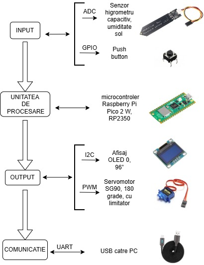

# SmartPlant: Sistem de monitorizare și irigare 

**Echipa BerryBusy:** Panaite Elena-Alexandra și Șalaru Ioana (Grupa 1309B)

---

## Descrierea Proiectului
SmartPlant este un sistem automatizat, bazat pe Raspberry Pi Pico 2w, creat pentru a monitoriza starea de sănătate a plantelor de apartament. Dispozitivul măsoară umiditatea solului și decide dacă este necesară irigarea. Interfața oferă feedback vizual printr-un display OLED, iar execuția irigării este simulată mecanic folosind un servomotor.

---

## Cerințe Funcționale
Sistemul implementează următoarele funcționalități de bază:
* Achiziție de date (ADC): Citirea valorilor analogice de la senzorul capacitiv de umiditate a solului la intervale regulate.
* Interfață Utilizator (I2C): Afișarea stării curente a solului și a meniului de configurare pe un ecran OLED.
* Control Utilizator (GPIO / Întreruperi): Navigarea prin meniul de moduri de funcționare.
* Element de Execuție (PWM): Activarea unui servomotor SG90 la atingerea pragului de uscăciune, simulând deschiderea unei valve de apă.
* Monitorizare la distanță (UART): Transmiterea log-urilor și a stării sistemului către un PC prin interfața serială USB.

---

## Cerințe Non-funcționale
* Modularitate Software: Codul este dezvoltat în **C (Pico SDK)** și este modularizat (drivere separate sensor, servo, menu, button, ssd1306).
* Eficiență și Timing: Arhitectură non-blocantă bazată pe timestamp-uri (time_us_64()) — niciun modul nu folosește sleep() în bucla principală.
* Fiabilitate:  Filtru de medie mobilă pe 32 de citiri ADC prin DMA pentru eliminarea zgomotului electric al senzorului capacitiv.
* Paralelism: Utilizarea ambelor core-uri ARM Cortex-M33 ale RP2350 — Core 0 gestionează logica timp-real, Core 1 gestionează exclusiv display-ul OLED.

---

## Scenarii de Utilizare

**1. Configurarea inițială și selecția profilului**
* La pornirea dispozitivului, display-ul OLED afișează meniul de selecție profil cu un countdown de 10 secunde. Utilizatorul navighează prin cele 5 profile prin apăsări scurte ale butonului. După 10 secunde fără interacțiune, profilul curent este confirmat automat și sistemul începe monitorizarea.

**2. Declanșarea irigării automate**
* Sistemul citește umiditatea la fiecare 2 secunde. Când valoarea scade sub pragul profilului activ, servomotorul se rotește la 90° pentru durata configurată, simulând deschiderea unui robinet. Display-ul afișează un timer vizibil cu bara de progres. Simultan, pe serial se trimite un mesaj JSON cu "udare":1. După terminarea udării, sistemul intră în cooldown de 30 de secunde.

## Arhitectura proiectului


## Arhitectura Software

**Structura modulară**
```
smart_plant/
├── smart_plant.c       — main(), Core 0, Core 1, shared state
├── button/
│   ├── button.h
│   └── button.c        — detecție apăsare prin întrerupere GPIO
├── menu/
│   ├── menu.h
│   └── menu.c          — mașină de stări, profile, desenare OLED
├── sensor/
│   ├── sensor.h
│   └── sensor.c        — citire ADC cu DMA, calibrare, medie mobilă
├── servo/
│   ├── servo.h
│   └── servo.c         — control PWM, logică udare non-blocantă
└── oled/
    ├── ssd1306.h
    └── ssd1306.c       — driver I2C, framebuffer, font 5x7
```

## Arhitectura dual-core

Sistemul utilizează ambele core-uri ale RP2350 pentru a elimina interferența dintre PWM (servo) și I2C (OLED):

### Core 0 — timp real, critic
- Citire senzor ADC prin DMA la fiecare 2 secunde  
- Logică udare: verificare prag, cooldown, acționare servo  
- Procesare evenimente buton prin întrerupere GPIO  
- Transmisie date JSON prin UART/USB la fiecare 5 secunde  
- Actualizare `shared_state` protejată cu spinlock  

### Core 1 — display
- Refresh OLED la interval fix de 500 ms  
- Citește `shared_state` în siguranță prin spinlock  
- I2C inițializat și utilizat exclusiv pe Core 1  

---

Comunicarea între core-uri se face printr-o structură `SharedState` protejată cu `spin_lock_t` din SDK-ul Pico:

```c
typedef struct {
    int umiditate;
    WateringState watering;
    int sec_left;
    char profil_nume[16];
} SharedState;
```


### Logica principală (Core 0)
Bucla `while(true)` din Core 0 este non-blocantă — nu conține niciun `sleep()`.  
Fiecare sarcină este executată doar dacă a trecut intervalul corespunzător, verificat prin `time_us_64()`:

| Sarcină                     | Interval                   |
|-----------------------------|----------------------------|
| Citire senzor umiditate     | 2 secunde                  |
| Verificare buton            | fiecare iterație (~µs)     |
| Logică udare                | fiecare iterație           |
| Actualizare `shared_state`  | fiecare iterație           |
| Transmisie UART/USB         | 5 secunde                  |


### Modulul sensor și logica de măsurare a umidității
Senzorul capacitiv produce o tensiune analogică invers proporțională cu umiditatea — sol uscat înseamnă tensiune mare, sol ud înseamnă tensiune mică. Citirea se face prin DMA pe 32 de sample-uri consecutive, după care se calculează media:
```c
umiditate% = (cal_dry - raw) * 100 / (cal_dry - cal_wet)
```
Valorile de calibrare implicite sunt cal_dry = 3200 (senzor în aer) și cal_wet = 800 (senzor în apă). Se recomandă calibrarea cu valorile reale măsurate.

### Modulul servo și logica de udare

Servomotorul SG90 simulează un robinet prin rotație între 0° (închis, puls 800µs) și 90° (deschis, puls 2500µs) la 50Hz. Logica de udare este non-blocantă — durata udării se numără prin timestamp, nu prin sleep().
Între două udări consecutive există un cooldown obligatoriu de 30 de secunde pentru a permite apei să fie absorbită de sol înainte de o nouă decizie.

## Modulul menu și profilele de udare

Sistemul include 5 profile predefinite pentru tipuri diferite de plante:

| Profil     | Exemple                 | Prag declanșare | Durată udare | Interval verificare |
|------------|--------------------------|------------------|--------------|----------------------|
| Arid       | cactus, suculente        | < 15%            | 2s           | 24h                  |
| Mediteran  | lavandă, rozmarin        | < 30%            | 4s           | 12h                  |
| Temperat   | monstera, pothos         | < 45%            | 6s           | 8h                   |
| Tropical   | orhidee, ferigi          | < 60%            | 8s           | 4h                   |
| Acvatic    | nufăr, papirus           | < 80%            | 15s          | 1h                   |

Navigarea între profile se face prin apăsare scurtă a butonului. După 10 secunde fără interacțiune, profilul curent este selectat automat (BUTTON_AUTO_SELECT). O apăsare scurtă în timpul monitorizării active revine în meniu.

### Modulul button și logica de navigare

Detecția apăsării se face prin întrerupere hardware pe GPIO_IRQ_EDGE_FALL și GPIO_IRQ_EDGE_RISE. Durata apăsării este măsurată cu time_us_64(). Semnalele sub 30ms sunt ignorate (debounce software). Evenimentele sunt stocate atomic în pending_event și consumate de bucla principală.

### Modulul ssd1306 și logica de afișare pe display

Driver complet pentru display-ul OLED 128×64px prin I2C. Folosește un framebuffer de 1024 bytes în RAM și un font 5×7 pixeli pentru caractere ASCII. Suportă text normal, text 2× mărit și bară de progres. Întregul framebuffer este trimis la display printr-un singur transfer I2C la fiecare refresh.

### Monitorizare la distanță (UART/USB)

Pico 2W transmite date prin USB serial (CDC) la fiecare 5 secunde în format JSON.  
Pentru monitorizare rapidă în timpul dezvoltării, datele au fost urmărite direct în **VS Code**, folosind extensia *Serial Monitor*, unde mesajele JSON apar în consolă în timp real:

```json
{"umiditate":45,"profil":"Temperat","udare":0,"sec_left":0}
```

Pentru logging sau vizualizare avansată pe PC se poate rula și un script Python:

```python
import serial, json

port = serial.Serial('COM6', 115200)
while True:
    linie = port.readline().decode('utf-8').strip()
    date = json.loads(linie)
    print(f"Umiditate: {date['umiditate']}%  Profil: {date['profil']}")
```
